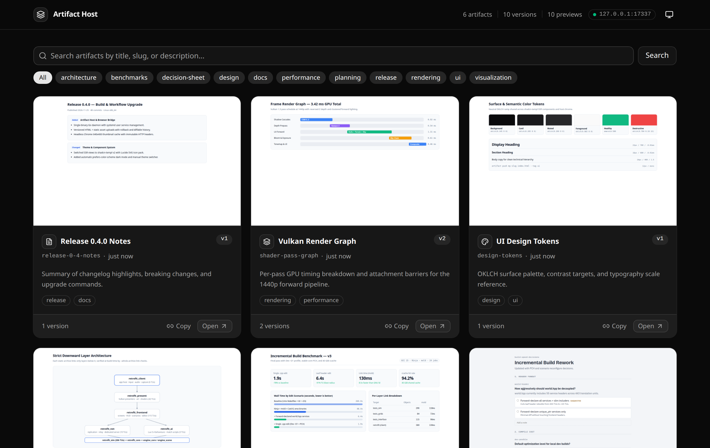
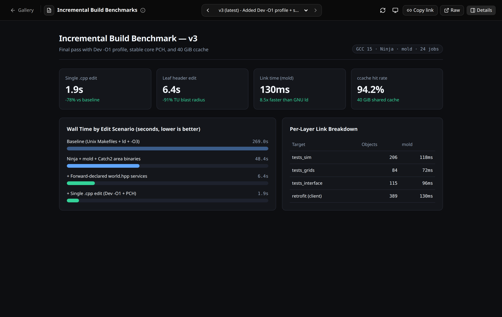
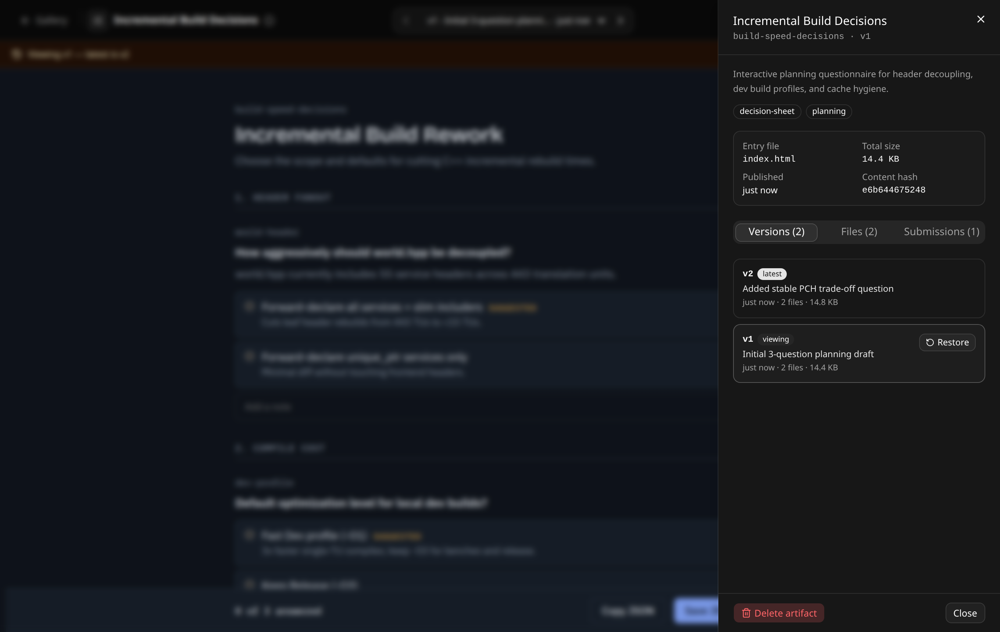
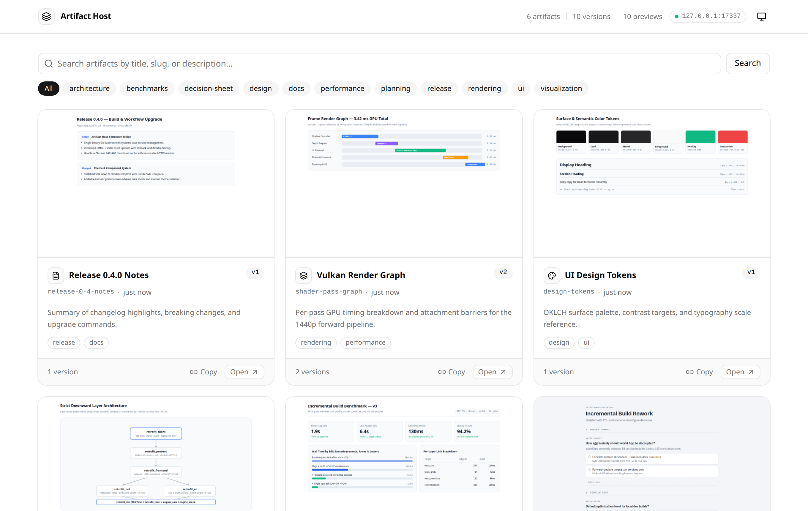

# artifact-host

**Interactive HTML artifacts for AI coding agents** — a local single-binary Go daemon, CLI, and [Agent Skill](skills/artifact-host/SKILL.md) that brings Claude-style interactive HTML artifacts, version history, cached page previews, and browser-to-agent submissions to **Antigravity**, **OpenAI Codex CLI**, **OpenCode**, **Claude Code**, **Gemini CLI**, **Cursor**, and any other agent with shell access.

<picture>
  <source media="(prefers-color-scheme: dark)" srcset="docs/screenshots/gallery-dark.png">
  <source media="(prefers-color-scheme: light)" srcset="docs/screenshots/gallery-light.png">
  
</picture>

## Why?

Claude's web interface supports interactive HTML artifacts (decision sheets, UI mockups, benchmark dashboards, architecture diagrams, interactive prototypes) along with a `window.claude.use('downloads')` bridge for exporting structured answers.

Local coding agents like **Antigravity**, **Codex**, **OpenCode**, and **Claude Code** either don't render interactive HTML artifacts at all or only display static Markdown documents — leaving agents to spawn throwaway `python3 -m http.server` processes on random ports with no history, no previews, and no way to get user input back cleanly.

`artifact-host` fixes that permanently:

- **One persistent background daemon (`systemd --user`)** at `http://127.0.0.1:7337` instead of orphaned one-off HTTP servers.
- **Versioned artifacts (`v1`, `v2`, `v3`, ...)** with full static asset bundling, instant version switching in the UI (`[` / `]`), and one-click rollback.
- **Cached headless-Chrome page previews** (640x400 thumbnails with immutable HTTP caching) so your root gallery shows every artifact at a glance.
- **Drop-in Claude Artifacts bridge (`window.claude.use('downloads')` + `window.artifact.save`)** automatically injected into hosted HTML pages — existing skills like `decision-sheet` work without modification, and agents can collect saved JSON directly via `artifact submissions <slug> --wait`.
- **Single static Go binary** (`CGO_ENABLED=0`, pure-Go SQLite, `//go:embed` assets) with a clean SSR UI (`templ` + `shadcn-templ` + Lucide icons, automatic `prefers-color-scheme` dark mode).
- **Ready-to-install Agent Skill** (`skills/artifact-host/SKILL.md`) so your coding agents know when and how to publish artifacts automatically.

## Screenshots

| Artifact Viewer & Version Switcher | Version History, Files & Submissions Drawer |
| --- | --- |
|  |  |

<details>
<summary>Light mode gallery</summary>



</details>

## Install the Agent Skill

Install the skill via the open [Agent Skills CLI](https://skills.sh/) (works across Antigravity, Codex, OpenCode, Claude Code, Cursor, and other compatible agents):

```bash
npx skills add DeaSTL/artifact-host
```

Or copy [skills/artifact-host/SKILL.md](skills/artifact-host/SKILL.md) directly into your agent's skills directory:

- **Antigravity / shared agents:** `~/.agents/skills/artifact-host/SKILL.md`
- **Claude Code:** `~/.claude/skills/artifact-host/SKILL.md`
- **Codex CLI:** `~/.codex/skills/artifact-host/SKILL.md`
- **OpenCode:** `~/.config/opencode/skills/artifact-host/SKILL.md`

## Install & Start the Daemon

Generated `*_templ.go` templates and compiled Tailwind CSS (`internal/ui/static/app.css`) are checked in, so building requires only **Go 1.26+** (no Node or CGo needed):

```bash
git clone https://github.com/DeaSTL/artifact-host.git
cd artifact-host
CGO_ENABLED=0 go build -trimpath -ldflags="-s -w" -o ~/.local/bin/artifact ./cmd/artifact
```

Install and start the `systemd --user` background service (listens on `127.0.0.1:7337`, stores SQLite DB and assets in `~/.local/share/artifact-host`):

```bash
artifact service install
artifact status
```

If `google-chrome` or `chromium` is on `PATH`, page preview thumbnails render automatically in the background; otherwise the UI serves clean SVG placeholders.

## How Agents Use It

### Publish & Iterate on Interactive Artifacts

```bash
# Publish v1 of a prototype, report, or visualizer with static assets
artifact push build-benchmarks ./report.html \
  --asset data.json=./metrics.json \
  --title "Incremental Build Benchmarks" \
  --description "Compile and link timings before/after header cleanup" \
  --icon bar-chart-3 \
  --tag benchmarks \
  --note "Initial baseline" \
  --json

# Push v2 to the same slug — metadata is preserved and both versions stay browsable
artifact push build-benchmarks ./report-v2.html \
  --asset data.json=./metrics-v2.json \
  --note "After forward-declaring services" \
  --json
```

Open the gallery at `http://127.0.0.1:7337/` or jump directly to `http://127.0.0.1:7337/a/build-benchmarks`.

### Two-Way Browser-to-Agent Submissions (Decision Sheets & Forms)

Every HTML entry file served under `/raw/<slug>/v/<N>/` automatically injects `/_artifact/bridge.js`, exposing two APIs:

```js
// Native artifact-host API
await window.artifact.save("answers.json", JSON.stringify(result), "application/json");

// Drop-in compatibility with Claude's Artifact downloads capability
const downloads = await window.claude.use("downloads");
await downloads.save({ filename: "plan-answers.json", data: JSON.stringify(result) });
```

When the user clicks Save in the browser, the payload is stored in SQLite on the daemon (and downloaded locally). The agent retrieves it without copy-pasting:

```bash
# Fetch the latest submission immediately
artifact submissions build-speed-decisions --latest

# Or block until the user submits from the browser
artifact submissions build-speed-decisions --wait --timeout 10m --out /tmp/answers.json
```

## CLI Reference

```text
artifact serve                         Run the HTTP daemon in the foreground
artifact push <slug> <file-or-dir>     Push HTML + static assets as a new version
artifact list [--search Q] [--tag T]   List hosted artifacts
artifact info <slug> [--version N]     Show artifact metadata, files, and submissions
artifact versions <slug>               List all versions of an artifact
artifact rollback <slug> <version>     Restore a prior version as a new latest version
artifact pull <slug> [--out DIR]       Download an artifact's files back to disk
artifact preview <slug> [--refresh]    Inspect or re-render a cached page preview
artifact submissions <slug> [--wait]   List, fetch, or wait for browser-saved files
artifact delete <slug> [--version N]   Delete an artifact or single version
artifact open <slug> [--version N]     Open an artifact in the default browser
artifact status                        Show daemon, cache, Chrome, and systemd status
artifact service <action>              install | uninstall | start | stop | restart | status | logs
artifact completion <shell>            Generate bash, zsh, fish, or powershell completions
```

Every query and mutation command supports `--json` for structured agent consumption.

## Development

To regenerate `templ` components and Tailwind CSS after UI changes:

```bash
npm install
make templ
make css
go test -race ./...
```
